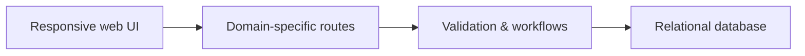

# Laravel Inventory

**Inventory / Warehousing** · PHP · Laravel · MySQL · Portfolio case study

> Warehouse inventory dashboard with stock adjustments, product catalogue and reorder alerts.

### At a glance

| | |
| --- | --- |
| **Core workflow** | Products → stock movements → reorder monitoring |
| **Highlights** | Stock adjustment transactions, SKU constraints, low-stock flags |
| **Persistence** | MySQL with Eloquent migrations |
| **Maturity** | Functional portfolio MVP — not production hardened |


## Engineering edition: measurable behaviour

- **Live read-only reporting:** `GET /api/insights` derives aggregates from stored business data (not hard-coded numbers).
- **Review path:** [Five-minute walkthrough](docs/DEMO.md) · [API reference](docs/API.md) · [Engineering decisions](docs/ENGINEERING.md).
- **License:** MIT. **Operational maturity:** local educational MVP, not an internet-facing production service.
- **Laravel CI:** validates feature tests with an ephemeral SQLite database; local setup is documented using MySQL.

## Product capabilities

- Add products with unique SKUs and reorder thresholds
- Record stock additions and removals with reasons
- Prevent reductions below zero stock
- Highlight low-stock products using Laravel Blade and MySQL

## Architecture



### Design decisions

- **Domain-specific modelling:** the entities and routes reflect a real inventory / warehousing workflow rather than generic records.
- **Portable setup:** the application can be run locally with documented tooling; no paid external API keys are required.
- **Explicit boundaries:** this is a demonstrable MVP. Auth, tenancy, logging, scalability and operational security need additional engineering before production use.

## Local development

Requirements: PHP 8.2+, Composer, running MySQL server, an empty MySQL database and credentials.

```bash
composer install
cp .env.example .env # On Windows: copy .env.example .env
php artisan key:generate
# Edit .env: DB_DATABASE, DB_USERNAME and DB_PASSWORD
php artisan migrate
php artisan serve
```
Visit http://127.0.0.1:8000.

This repository includes a Laravel application skeleton and project-specific routes, models, migrations and Blade views. Composer creates `vendor/`; no vendored dependencies or private credentials are stored.

## Tests

```bash
composer install
php artisan test
```

The GitHub Actions workflow runs Laravel feature tests with SQLite. These tests cover representative workflows and validations; they do not imply comprehensive security or load testing.

## API and UX

The project provides a browser-based demo using Laravel Blade and form-backed actions. See the application source for concrete endpoints. No hosted demo is claimed.

## Roadmap

- Warehouse locations; stock reservations.
- Authentication, authorisation, secure secrets management, and deployment configuration.
- Database migrations and backups where not already available, along with comprehensive accessibility and end-to-end testing.

## Security and scope

Local demonstration only; do not deploy publicly with real customer data as-is. The `.env.example` documents configuration; do not commit `.env`, credential files, database files, or third-party API keys. See [SECURITY.md](SECURITY.md).

## Project maintenance

- [CONTRIBUTING.md](CONTRIBUTING.md) — development conventions and review expectations
- [.github/workflows/checks.yml](.github/workflows/checks.yml) — automated checks
- [CHANGELOG.md](CHANGELOG.md) — release notes
