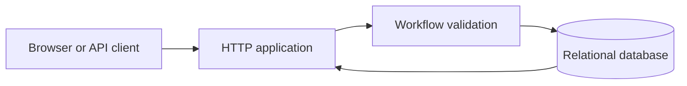

# Engineering decisions — laravel-inventory

## System boundary

This is a **single-process portfolio application**, designed for local evaluation and reproducible functional tests. It is intentionally not marketed as a multi-tenant SaaS product.

## Domain workflow

**SKU creation → initial balance → transactionally adjusted stock → reorder alerts**.

## Trade-offs and rationale

1. **Scope over novelty:** a focused domain model lets a reviewer follow a complete business workflow without external services.
2. **Local-first persistence:** database files are ignored by git, and test suites use disposable databases. SQLite is deliberately used in non-Laravel projects; the Laravel projects use Eloquent and MySQL for the documented local runtime.
3. **Observable behaviour:** `/api/insights` produces live read-only counts and business metrics from persisted data. Other than the counts, this endpoint does not expose detailed records.
4. **Explicit limitations:** A MySQL-backed demonstration without authentication; inventory movement history is not an accounting-grade audit ledger.

## Technical debt deliberately left visible

- No account system, tenancy isolation or role-based permission checks. Do not expose application write endpoints publicly without implementing them.
- No tracing, centralised logs, distributed workers or managed backups.
- CI exercises functional behaviour but does not establish SOC 2, GDPR compliance, or production fitness.
- Schema versioning, dependency pinning, audit policy and threat modelling must be expanded before real deployment.

## Production-readiness gate

- [ ] Identity, permissions and tenancy (where appropriate)
- [ ] Threat model and security review
- [ ] Dependency lockfiles and supply-chain checks
- [ ] Migration, rollback and backup strategy
- [ ] Observability (structured logs, metrics, tracing, alerts)
- [ ] SLOs, load tests and incident runbooks
- [ ] Full CI and deployment smoke test
- [ ] Accessibility and browser E2E coverage
